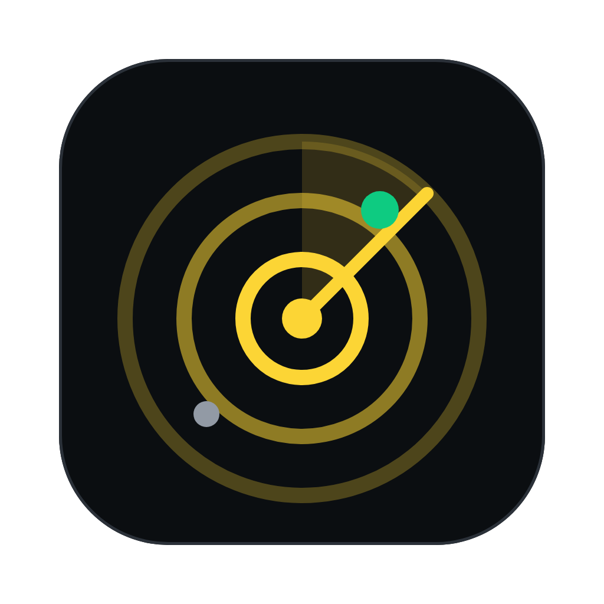

<p align="center"></p>

# Thingscan

Finds smart-home devices on your network and nearby over Bluetooth, the way the Samsung
SmartThings app's "scan nearby" does, and keeps an eye on the ones you add. It's a Tauri 2
desktop app plus a CLI, both on one Rust core, and a SwiftUI iPhone app that controls the same
devices. A small account server you host keeps them in sync, end-to-end encrypted. It was built from a reverse-engineering pass over
SmartThings for iOS 1.7.52 (`com.samsung.oneconnect4ios`).

## How to run

Thingscan has four parts:

| part | what it is | where |
| --- | --- | --- |
| **Mac app** | the main app: scan, add, check, TV remote, appliance controls, menu bar panel | `src-tauri/` + `src/` |
| **iPhone app** | the same controls on your phone | `ios/` |
| **Account server** | email + password accounts that sync devices between your Macs and iPhones from anywhere; it only ever sees them encrypted | `crates/thingscan-server/` + `deploy/` |
| **CLI** | a one-shot scan in the terminal | `crates/thingscan-cli/` |

### What you need

- A Mac on the same Wi-Fi as your TV and appliances.
- [Rust](https://rustup.rs) 1.85 or newer (the crates use edition 2024).
- Node.js 20.19+ or 22.12+ with npm (Vite 8 needs one of those).
- Xcode 16 or newer, for the iPhone app. The iPhone needs iOS 17 or newer.
- For the account server: a VPS with Docker and a domain name (or just `cargo run` locally to try).
- Optional, for air conditioners, washers and other appliances: your SmartThings account. You
  connect it once with a personal access token from
  [account.smartthings.com/tokens](https://account.smartthings.com/tokens) and a sign-in; after
  that Thingscan keeps access by itself (see
  [Keeping SmartThings connected](#keeping-smartthings-connected)). The TV remote doesn't need it.

### 1. The Mac app

```sh
npm install
npm run tauri dev          # opens Thingscan; Vite serves the UI on :1440 with hot reload
```

On first launch:
1. Allow **Bluetooth** and **Local Network** when macOS asks. Without Local Network access the
   scan finds nothing.
2. Go to **Add device**. The scan runs while that screen is open. Add your TV and appliances,
   giving each a name and a room.
3. To control appliances, click the **person icon** (top right) → **Connect SmartThings**, paste
   a personal token (tick the Devices and the Apps scopes), then sign in to SmartThings in the
   window that opens and choose **Allow**.
4. Open the TV from Home. The first time, the TV asks you to **Allow** the remote.

Closing the window keeps Thingscan in the menu bar (radar icon); ⌘Q quits. To try things without
touching your real devices list, point a second copy at scratch data:
`THINGSCAN_DATA_DIR=/tmp/thingscan-scratch npm run tauri dev`.

### 2. The iPhone app

1. Open `ios/Thingscan.xcodeproj` in Xcode.
2. Under **Thingscan target → Signing & Capabilities**, the team is *andre oliveira (Personal
   Team)*. With another Apple ID, pick your own team. If Xcode says the bundle ID is taken, change
   `app.thingscan.ios` to something unique.
3. Connect the iPhone with a cable. If **Developer Mode** is off, turn it on (Settings → Privacy
   & Security → Developer Mode) and restart the phone.
4. Choose the iPhone as the run destination at the top of Xcode and press **Run** (⌘R).
5. The first time, iOS blocks apps from a free account. On the phone, go to Settings → General →
   VPN & Device Management, trust your developer certificate, and open Thingscan again.
6. Allow **Local Network** (required) and **Bluetooth** when asked.
7. Bring your devices over, either way:
   - **Thingscan account** (works anywhere): tap the person icon → **Sign in** with the account
     you made on the Mac. See [step 3](#3-your-thingscan-account).
   - **Direct pairing** (home Wi-Fi only, no server): on the Mac, click the person icon →
     **Pair an iPhone**, which shows a 6-digit code. On the iPhone, tap the person icon →
     **Pair with Mac**, pick your Mac and type the code.

The phone then has your devices and the SmartThings token. It syncs again every
time you open it, and you can pull down on Home to sync by hand. With direct pairing the Mac app
has to be running for the phone to sync; either way the phone keeps working with what it has.

To run without a phone, pick an iPhone simulator as the destination. The simulator uses the Mac's
network but has no Bluetooth.

### 3. Your Thingscan account

An account keeps your devices and SmartThings token in sync between your Macs and
iPhones wherever they are, through a small server you run (on your VPS, see
[Deployment](#account-server-your-vps)). Everything is encrypted with a key derived from your
password before it leaves a device, so the server can't read it.

To try it on your Wi-Fi first:

```sh
THINGSCAN_DB=/tmp/thingscan.db cargo run -p thingscan-server     # listens on :8080
```

1. On the Mac: person icon → **Create account**. Server `http://<this Mac's IP>:8080` (plain
   `http://` is accepted for testing; on the VPS it's `https://`), your email, and a password of
   at least 8 characters.
2. On the iPhone: person icon → **Sign in**, with the same server, email and password.

From then on each device syncs a moment after you change something, every minute while it's
open, and on **Sync now** (or pulling down on the iPhone's Home). While the iPhone is signed in,
it doesn't use the direct Mac pairing.

### 4. The CLI

```sh
cargo run -p thingscan-cli -- -v                  # scan for 8s and print a table
cargo run -p thingscan-cli -- --check --json      # scan, re-check each device, print JSON
```

| flag | meaning |
| --- | --- |
| `-t, --timeout <s>` | listen time (default 8) |
| `-o, --only <list>` | any of `mdns,ssdp,ocf,ble,wifi` |
| `--json` | JSON instead of a table |
| `-v, --verbose` | print all details under each device |
| `--check` | after scanning, check each device answers again (what the app does on launch) |
| `--all-ble` | list every BLE advertiser, not just Samsung / SmartThings / Matter |
| `--mdns-type <t>` | browse an extra DNS-SD type (repeatable), e.g. `_hap._tcp` |
| `--no-ocf-sweep` | OCF over multicast only; skip the unicast subnet probe |
| `--no-enrich` | don't query Samsung TVs' `:8001/api/v2/` |

### Tests and checks

```sh
cargo test --workspace                            # core, app store and both sync paths, account server
cargo clippy --workspace --all-targets && cargo fmt --all --check
npx tsc --noEmit                                  # the Mac app's TypeScript
cd ios && xcodebuild test -scheme Thingscan \
  -destination 'platform=iOS Simulator,name=iPhone 17 Pro' -only-testing:ThingscanTests
```

`ThingscanUITests` drives the simulator against real servers and saves a screenshot of each
screen to `TEST_RUNNER_SHOTS=<dir>`. Run the same `xcodebuild test` with
`-only-testing:ThingscanUITests`; each test is skipped unless its servers are given. In the
simulator, `127.0.0.1` is the Mac.
- `testPairSyncAndBrowse`: show a code on the Mac (person icon → *Pair an iPhone*), then set
  `TEST_RUNNER_MAC_ADDRESS=127.0.0.1:47640 TEST_RUNNER_MAC_CODE=<code>`.
- `testAccountSync`: an account a Mac has filled, with
  `TEST_RUNNER_ACCOUNT_SERVER=http://127.0.0.1:8080 TEST_RUNNER_ACCOUNT_EMAIL=… TEST_RUNNER_ACCOUNT_PASSWORD=…`.
  It renames the TV on the phone, then waits for the Mac to rename the A/C to "Bedroom A/C".
- `testSheets`: needs nothing; opens the sign-in sheet, and the add sheet for whatever the scan
  finds nearby (cancelled).

### macOS permissions

- **Bluetooth**: the app asks on first use (its Info.plist has the usage text). For the CLI and
  `tauri dev`, allow your terminal under System Settings → Privacy & Security → Bluetooth.
- **Local Network**: macOS may prompt the first time; allow it, or SSDP/OCF/mDNS see nothing.
- **Wi-Fi setup networks** need SSIDs, which macOS hides from apps without Location Services
  access. `system_profiler` also takes about 15s, so the app gives Wi-Fi 20s and the CLI needs
  `--only wifi -t 20`. On Linux it uses `nmcli`.
- **Firewall**: if the macOS firewall is on, allow incoming connections for Thingscan. The
  iPhone syncs over TCP port 47640.

## Deployment

### Account server (your VPS)

`deploy/` runs the server in Docker behind [Caddy](https://caddyserver.com), which gets and
renews the HTTPS certificate by itself.

1. Point a domain at the VPS with an `A` record (and `AAAA` for IPv6), e.g. `sync.example.com`,
   and open ports 80 and 443.
2. Install Docker with the Compose plugin on the VPS and copy this repository there (`git clone`,
   or `rsync -a --exclude target --exclude node_modules ./ vps:thingscan/`).
3. Configure and start it:
   ```sh
   cd thingscan/deploy
   cp .env.example .env                          # set THINGSCAN_DOMAIN=sync.example.com
   docker compose up -d --build
   curl https://sync.example.com/v1/health       # {"app":"thingscan-server","version":"0.1.0"}
   ```
4. In the apps, create the account (or sign in) with the server `sync.example.com`.
5. Once everyone who should have an account has one, set `THINGSCAN_ALLOW_SIGNUP=false` in `.env`
   and run `docker compose up -d` again.

Running it:
- **Update:** `git pull && docker compose up -d --build`.
- **Accounts:** `docker compose exec server thingscan-server list-users`, and
  `docker compose exec server thingscan-server delete-user you@example.com`. Deleting is also the
  answer to a forgotten password: nobody can open the vault without it, so the account starts
  over and the apps upload their devices again when you sign in.
- **Backup:** everything is one SQLite file in the `deploy_server-data` volume. Stop the server,
  copy it, start it again:
  `docker compose stop server && docker run --rm -v deploy_server-data:/data -v "$PWD":/backup debian:bookworm-slim tar czf /backup/thingscan-data.tgz -C /data . && docker compose start server`.
- **Logs:** `docker compose logs -f server`.

The image builds from the repository root (`deploy/Dockerfile`): a Rust build stage, then a
Debian slim image of about 140 MB that runs as an unprivileged user and listens on 8080 inside the
Compose network only. Settings: `THINGSCAN_DB` (default `/data/thingscan.db`), `THINGSCAN_ADDR`
(`0.0.0.0:8080`), `THINGSCAN_ALLOW_SIGNUP` (`true`).

### Mac app

```sh
npm run tauri build
```

This builds an optimized release, which takes about 5 minutes, and writes:
- `target/release/bundle/macos/Thingscan.app` (about 13 MB): drag it to `/Applications`.
- `target/release/bundle/dmg/Thingscan_0.1.0_aarch64.dmg` (about 7 MB): a disk image to hand to
  someone else.

These are Apple Silicon builds. For a build that also runs on Intel Macs, run
`rustup target add x86_64-apple-darwin` once, then
`npm run tauri build -- --target universal-apple-darwin`.

The installed app and `npm run tauri dev` share the same data folder
(`~/Library/Application Support/app.thingscan.desktop`). Your devices, token and paired phones
carry over, but quit one before opening the other. Otherwise the second copy gets a random sync
port instead of 47640, and the phone has to find the Mac again over Bonjour.

To start it at login, add Thingscan under System Settings → General → Login Items.

**Signing.** The build isn't signed with a Developer ID or notarized. It opens normally on the Mac
that built it. On another Mac, the first open needs right-click → **Open**, or
`xattr -dr com.apple.quarantine /Applications/Thingscan.app`. Signing for distribution needs the
paid Apple Developer Program, because the current team is a free Personal Team. Once that's set
up, `tauri build` signs and notarizes when these are set:
- `APPLE_SIGNING_IDENTITY="Developer ID Application: …"`
- `APPLE_ID`, `APPLE_PASSWORD` (an app-specific password) and `APPLE_TEAM_ID`

### iPhone app

**An .ipa to install with Apple Configurator:**
1. Prepare the iPhone once: connect it with a cable, unlock it and tap **Trust This Computer**,
   then turn on **Developer Mode** (Settings → Privacy & Security → Developer Mode; the switch
   appears after the iPhone has been connected to a Mac with Xcode) and restart it.
2. With the iPhone still connected, build:
   ```sh
   ios/build-ipa.sh            # → ios/build/Thingscan.ipa
   ios/build-ipa.sh --install  # the same, then installs it on the connected iPhone
   ```
   It registers the connected iPhone with the signing team (a free Personal Team can only sign
   for registered iPhones), archives a Release build and exports it with `ios/ExportOptions.plist`
   (development signing, the only kind a free team gets). Later builds work without the iPhone
   connected, for any iPhone registered before.
3. Install it from the Mac, with the iPhone connected: `--install` above, or in Apple
   Configurator select the iPhone, then **Add → Apps → Choose from my Mac…** and pick
   `ios/build/Thingscan.ipa`. Sending the .ipa to the iPhone and opening it there (AirDrop,
   Files, Messages) always fails with "Unable to install": iOS only installs development-signed
   apps pushed from a Mac.
4. On the iPhone, trust the developer once: Settings → General → VPN & Device Management →
   **Apple Development: <your Apple ID>** → **Trust**. Until then the app refuses to open ("its
   profile has not been explicitly trusted by the user"). Then open Thingscan and allow Local
   Network and Bluetooth.

**With the free Personal Team (current setup):**
- Install with the .ipa above, or by running from Xcode as in [The iPhone app](#2-the-iphone-app).
  For everyday use from Xcode, set Product → Scheme → Edit Scheme → Run → Build Configuration to
  **Release** first.
- Apps from a free team stop opening after **7 days**. Run `ios/build-ipa.sh` again and install
  the new .ipa over the old one (or press Run in Xcode). The devices, account and token stay on
  the phone.
- A free team can have at most 3 of its apps on a phone at once.

**With a paid Apple Developer Program team** (needed for TestFlight, or installs that last a year):
1. Choose that team under Signing & Capabilities.
2. Raise the version or build number (target → General → Identity) for each upload.
3. Product → Archive, then in the Organizer: **Distribute App → TestFlight & App Store** (or
   Release Testing for an ad-hoc build).
4. Install TestFlight on the iPhone and accept the build.

To check that the device build compiles without signing:
`xcodebuild -project ios/Thingscan.xcodeproj -scheme Thingscan -configuration Release -destination 'generic/platform=iOS' CODE_SIGNING_ALLOWED=NO build`.

### CLI

```sh
cargo install --path crates/thingscan-cli         # installs `thingscan` into ~/.cargo/bin
thingscan -v
```

## Project layout

- `crates/thingscan-core`: the scanners (`ocf`, `ssdp`, `mdns`, `ble`, `softap`), `scan` (runs them together and streams merged devices) and `reach` (checks saved devices).
- `crates/thingscan-cli`: the `thingscan` binary.
- `crates/thingscan-server`: the account server (axum + SQLite), and its `list-users` /
  `delete-user` commands.
- `deploy/`: the server's Dockerfile, Docker Compose file with Caddy, and `.env.example`.
- `src-tauri`: the app's commands, the `devices.json` store, account sync (`vault.rs`) and the
  direct iPhone pairing server (`sync.rs`).
- `src/`: vanilla TS UI, following `DESIGN.md`. `index.html` is the main window and
  `tray.html` (`src/tray.ts`) is the menu bar panel; `src-tauri/src/tray.rs` is the menu bar
  icon.
- `ios/`: the iPhone app. `Net/` ports the scanners and checks to Swift (BSD UDP sockets for OCF,
  Network.framework for Bonjour, CoreBluetooth), plus the TV remote, the SmartThings client and
  `AccountSync` (the account, same keys and merge as `vault.rs`) and `MacSync` (direct pairing).
  `Model/AppModel.swift` holds the state, and `Views/` the screens.

Where things are stored:

| | Mac | iPhone |
| --- | --- | --- |
| added devices (with TV pairing tokens) | `~/Library/Application Support/app.thingscan.desktop/devices.json` | `devices.json` in the app's Application Support, with complete file protection |
| SmartThings token (and, once signed in, its refresh token) | `smartthings.json` there, mode 0600 | Keychain (`smartthings-token`, and `smartthings-oauth` for the refresh token) |
| Thingscan's SmartThings app (client ID and secret) | `smartthings-app.json` there, mode 0600 | Keychain (`smartthings-app`) |
| sync pairing | `phones.json` there, mode 0600 (the per-phone AES key) | Keychain (`mac-sync-key`) for the key; UserDefaults for the Mac's name and address |
| Thingscan account (session and vault key) | `thingscan-account.json` there, mode 0600 | Keychain (`thingscan-account`) |
| removed devices, so sync doesn't bring them back | `removed` in `devices.json` | `removed.json` next to `devices.json` |

The account server keeps, per account, an Argon2id hash of a key derived from the password, the
vault key sealed with another password-derived key, and the vault as ciphertext. Nothing goes to
iCloud. Set `THINGSCAN_DATA_DIR=/some/dir` to run a Mac copy against scratch data.

## What it does

### The app

- **Home** lists the devices you added, grouped by room. Opening the app checks that every one
  of them still answers, and so does coming back to it after 5 minutes or pressing *Check again*:
  - OCF devices get a unicast `GET /oic/d` on port 5683, which must return the same device ID.
  - UPnP devices get their description URL re-fetched, which must return the same UDN.
  - Samsung TVs get their `:8001` API queried, which also gives the power state.
  - mDNS instances must resolve again.
  - Bluetooth devices must be heard advertising within 4s.

  Each card shows *Reachable* with a latency, *Not responding · seen 2 h ago*, or *Can't check*,
  plus a chip per channel coloured by its result.
- **Moved devices**: when a LAN device doesn't answer at its saved address, a short OCF, SSDP and
  mDNS scan looks for its stable IDs (`ocf:<di>`, `upnp:<udn>`, …). If the device turns up at a
  new address, that address is saved.
- **Add device** scans only while that screen is open:
  - Results stream in, split into *Ready to add* (devices in setup mode) and *Found nearby*.
  - Each channel shows a spinner, then a count, or a warning with the reason as a tooltip.
  - Devices already in the home show *Added*.
  - Adding one asks for a name and room, then returns home and checks it right away.
  - Leaving the screen stops the scan.
- **Device panel**: click a card to open it on the **Remote** tab for a TV, or the
  **Controls** tab for anything else. **Details** shows each check's target, result and latency,
  checks it now, shows its IDs, or removes it.
- **Names and rooms** can be changed any time:
  - The pencil on a card, or in the device panel's header, opens *Edit device*.
  - The pencil on a room heading renames that room for every device in it. Clearing the name
    takes them out of any room, and using another room's name merges the two.
- **TV remote** (Samsung Tizen TVs, local, no account needed):
  - Connects to the TV's own remote API (`wss://<tv>:8002/api/v2/channels/samsung.remote.control`).
    The first time, the TV asks you to Allow; the token it returns is saved with the device.
  - Buttons: power (hold it to switch a Frame TV fully off), source, mute, volume (left) and
    channel (right) rockers with up/down arrows, a D-pad with OK, back, home, menu, playback,
    Netflix / YouTube / Prime Video / Disney+, and a number pad.
  - Held keys act like a real remote's: volume, channel and the arrows repeat, and power keeps
    sending `Press` until it's let go (a single long `Press` only reads as a tap, which puts a
    Frame TV in Art mode).
  - **Touchpad** mode swaps the D-pad for a trackpad that moves the TV's pointer (dragging sends
    `ProcessMouseDevice` moves, a tap clicks), for browser and app screens without arrow
    navigation. Sliding a second finger on the iPhone, or a two-finger scroll on the Mac, sends
    channel up/down, which scroll the TV's browser. OK stays below it, and the volume and channel rockers stay beside it. The choice
    is remembered.
  - Keyboard: arrows, Enter, Backspace, + and −, M, H, digits.
  - When the TV is off, *Turn on TV* sends Wake-on-LAN to its MAC and, when the TV is linked to
    SmartThings, SmartThings' `switch on` as well (a TV in standby stays connected to
    SmartThings). The MAC is learned from the TV's API while it's on, or from the ARP cache.
    This needs "Power on with mobile" enabled on the TV. For the iPhone, see below.
- **Appliance controls** (through your SmartThings account):
  - Samsung appliances' own OCF control resources answer plain CoAP with 4.03 and only accept
    the DTLS credentials of the owning account; `/oic/sec/doxm` says `owned: true`. So, like
    the SmartThings app, Thingscan sends commands through `api.smartthings.com`.
  - The **account menu** (person icon, top right) shows the SmartThings status and your token,
    masked to its last four characters. It can show the token in full or copy it, and has
    *Sign in again* (or *Replace token*) and *Disconnect*. The full token is only fetched from
    the backend when you reveal or copy it.
  - **Connect SmartThings** (account menu, or a device's Controls tab): see
    [Keeping SmartThings connected](#keeping-smartthings-connected). The token is kept in
    `smartthings.json` in the data folder with mode 0600.
  - Saved devices are linked to their SmartThings device by OCF device ID: the cloud `ocf`
    capability's `di` equals what the scan saw. A device without one, such as a TV found over
    UPnP, is linked to the only SmartThings device of its exact model, but only if neither side
    has a second unlinked device of that model. Anything else gets a one-time picker.
  - Controls are built from the capabilities each device reports:
    - **Air conditioners:** power, room temperature and humidity, target temperature within the
      device's own range, mode, fan speed, swing, WindFree/special modes, and the display light.
      The light uses `samsungce.airConditionerLighting` → `setLightingLevel` where the A/C allows
      it. Models that list that capability as disabled (such as `ARA-WW-TP1-22-COMMON`) take it
      through `execute` on the OCF resource `mode/vs/0` with
      `{"x.com.samsung.da.options": ["Light_Off"]}`, and that option turns the light **on**
      (`Light_On` turns it off; checked on a real unit). The state still reads from
      `samsungce.airConditionerLighting.lighting`.
    - **Washers and dryers:** state, job, time left and progress, Start / Pause / Stop (disabled
      with an explanation when the machine's remote control is off), and spin, water
      temperature, rinses and soil level.
    - **Everything:** energy use, plus everything else the device reports.
  - The Add screen also lists **devices in your SmartThings account** that weren't found nearby,
    such as a washer that isn't on the LAN. Their reachability comes from SmartThings' health
    API and shows as *Online on API*. A TV in standby also counts as online there.
- "Adding" means Thingscan remembers and watches the device. It doesn't put a device in setup
  mode onto your Wi-Fi; that still happens in its maker's app.

- **Menu bar addon**:
  - Thingscan puts a radar icon in the macOS menu bar. Clicking it opens a panel listing every
    added device, grouped by room, with its live status.
  - Clicking a device opens its controls inside the panel: the remote for a TV, and temperature,
    mode and fan for an air conditioner. Washers and the rest work the same way, using the same
    components as the main window.
  - The panel also has Add device, Open Thingscan, and a re-check button. Escape steps back, then
    closes the panel.
  - Right-click the icon for Open Thingscan / Check devices / Quit.
  - Closing the main window keeps Thingscan running in the menu bar; the Dock icon or Open
    Thingscan brings it back, and Quit or ⌘Q exits.
  - Both windows stay in sync: device edits emit `devices-changed`, check results are broadcast
    as `device-checked`, and the latest results are cached so the panel shows statuses
    immediately. Opening the panel re-checks devices when the last check is over 2 minutes old.

- **Thingscan account**: sign in on each Mac and iPhone (person icon → *Sign in*) and they share
  one device list and the SmartThings token, from anywhere. Edits go both ways;
  see [Thingscan account sync](#thingscan-account-sync).

- **iPhone app**: carries your devices around, synced through the account or paired with the Mac.
  - Direct pairing: person icon → *Pair with Mac*. It finds the Mac over Bonjour (or takes its
    address), and you type the 6-digit code the Mac shows under person icon → *Pair an iPhone*.
    Every launch then pulls the Mac's devices and SmartThings token. Renames made
    on the phone are kept, devices removed on the Mac leave the phone too, and devices added on
    the phone stay. While the phone is signed in to an account, the account is used instead.
  - Every launch checks every device; pull down on Home to sync and check again.
  - It works on its own as well: its own scan (OCF sweep, Bonjour, Bluetooth), reachability
    checks, TV remote with touchpad, appliance controls, and editing names and rooms.
  - iOS doesn't let apps send multicast or broadcast without Apple's multicast entitlement, which
    a free Personal Team can't get (the SmartThings app has it). So the phone skips SSDP, and its
    *Turn on* (shown when the remote finds the TV off) does three things at once: Wake-on-LAN sent straight to the TV's address (which
    gets through while the phone still knows the TV's MAC from when it was last on), a request to
    the paired Mac to broadcast Wake-on-LAN for it, and SmartThings' `switch on` when the TV is
    linked. Any one of them is enough. Opening the remote while the TV is on teaches the phone
    the TV's MAC.

### Keeping SmartThings connected

Since 30 December 2024, SmartThings makes every new personal access token expire after 24 hours,
and there's no setting for longer. What it supports for lasting access is OAuth through an app of
your own (an "OAuth-In" app, the kind `smartthings apps:create` makes): its access token also
lasts 24 hours, but it comes with a refresh token that buys a new pair. So Thingscan does this:

1. **Connect SmartThings** takes a personal token with the Devices scopes, which works straight
   away. If you ticked the Apps scope too, Thingscan uses it once to make its own SmartThings app
   (`POST /v1/apps`: `API_ONLY`, `CONNECTED_SERVICE`, scopes `r:devices:* w:devices:*
   x:devices:* r:locations:*`, redirect `https://httpbin.org/get`) and keeps the client ID and
   secret, which SmartThings only shows once.
2. **Sign in to SmartThings** opens SmartThings' own sign-in page in a Thingscan window (a sheet
   on the iPhone). You sign in with your Samsung account and choose **Allow**. When the page
   heads back to the redirect with the code, Thingscan reads the code, stops it there and trades
   it at `https://api.smartthings.com/oauth/token` for an access and a refresh token.
3. From then on, whichever device notices the access token has less than 6 hours left renews
   it. A running Mac looks every 10 minutes; the iPhone looks when it opens and each minute
   while it's open. If SmartThings turns a token down anyway, the app syncs (another device may
   have renewed it) or renews it, then tries again once.

A refresh token works once, and using it retires the access token before it, so all your Macs
and iPhones share one: renewals travel through your Thingscan account, newest first. An iPhone
paired only with the Mac (no account) doesn't renew the token the Mac sent it; the Mac does, and
the phone picks it up when it syncs. If you sign in to SmartThings on the iPhone itself, the phone
keeps that token and renews it on its own, and the Mac keeps its own; the phone only takes the
Mac's again if SmartThings refuses its own. The chain only breaks if no device renews for 29 days, or if two renew at
the same moment and the loser's result is lost; then **Sign in again** in the Mac's account menu
(*Connect again* on the iPhone) fixes it without a new personal token.

Already made an app with the SmartThings CLI? Enter its client ID and secret under *Made an OAuth
app with the SmartThings CLI?* in the connect dialog instead of a token; its redirect URI must be
`https://httpbin.org/get`.

Two other ideas were ruled out. Signing in with your Samsung email and password to make a fresh
personal token every day would mean storing your Samsung password and driving
account.samsung.com's sign-in page, with its captchas and two-step verification, which breaks
easily and goes against Samsung's terms. Doing without the account isn't possible for
appliances: they only take commands over DTLS from the account that owns them (see Appliance
controls). The TV doesn't need it: its remote and Wake-on-LAN are local, and SmartThings only
adds another way to turn it on.

### Mac ↔ iPhone sync

The Mac advertises `_thingscan._tcp` (TXT `name`, `port`, `ip`) and serves HTTP on port 47640,
or a free port when that one is taken:

- `GET /v1/info`: the Mac's name, and whether a pairing code is showing.
- `POST /v1/pair`: `{phoneName, publicKey, proof}` → `{pairingId, macPublicKey, macName}`. The
  phone proves it knows the code without sending it:
  `proof = HMAC-SHA256(SHA-256("thingscan-code:" + code), phone_public)`. A code lasts 5 minutes
  and allows 5 wrong tries.
- `GET /v1/sync` with header `X-Thingscan-Pairing: <id>`: `{sealed}`, which is the device list
  and SmartThings token (with its OAuth grant, when it renews itself) sealed with AES-256-GCM
  (nonce ‖ ciphertext ‖ tag, with the pairing id as associated data).
- `POST /v1/wake` with the same header and `{sealed}` of `{mac, sentAt}` under the same key:
  the Mac broadcasts Wake-on-LAN to that MAC for the phone. Requests whose `sentAt` is more than
  2 minutes off are refused.
- Key: X25519 between fresh phone and Mac keys, then
  `HKDF-SHA256(salt "thingscan-sync-v1", info phone_public ‖ mac_public)`. Rust and CryptoKit
  are checked against the same vectors on both sides.

### Thingscan account sync

The server (`crates/thingscan-server`) never sees a password or a device. Each app derives, from
the email and password:
- `master = PBKDF2-HMAC-SHA256(password, SHA-256("thingscan-account-v1:" + email), 600 000)`
- `authKey = HKDF-SHA256(master, info "thingscan-auth")`, the only thing sent to sign in. The
  server stores it as an Argon2id hash.
- `wrapKey = HKDF-SHA256(master, info "thingscan-wrap")`, which seals a random 32-byte vault key
  (AES-256-GCM, associated data `thingscan-vault-key`). The server keeps that sealed key for the
  next sign-in.

The vault is one JSON document (`format`, `devices`, `removed`, `smartthings`) sealed with the
vault key, associated data `thingscan-vault:<user id>`. Format 2 lets `smartthings` carry an
OAuth grant (`oauth: {clientId, clientSecret, refreshToken, expiresAt}`); an app that only knows
format 1 refuses to sync until it's updated, rather than drop the grant. The Rust and Swift sides check the same
key vectors, and the phone opens a vault the Mac sealed.

| endpoint | does |
| --- | --- |
| `POST /v1/signup` `{email, authKey, wrappedKey, device}` | creates the account → `{userId, email, token}` |
| `POST /v1/login` `{email, authKey, device}` | → `{userId, email, token, wrappedKey}`; 10 wrong passwords lock the email for 15 minutes |
| `GET /v1/vault?known=<version>` | → `{version, vault}`, or `{unchanged: true}` |
| `PUT /v1/vault` `{baseVersion, vault}` | → `{version}`, or 409 with the current vault when another device wrote first |
| `POST /v1/logout`, `GET /v1/health` | |

Sessions are bearer tokens, stored hashed, and expire after 180 days without use. A sync reads
the vault, merges it with what the device has, saves the result locally, and writes it back
(based on the version it read) only if that adds something. Both apps merge the same way:
- A device's name, room and SmartThings link come from its newest edit (`editedAt`).
- TV pairing tokens never sync, by either path. A Samsung TV only honours a token on the device
  it gave it to, so each Mac and iPhone allows the remote once on the TV and keeps its own.
  (Syncing them made the TV ask the iPhone every time: the Mac's token overwrote the phone's.)
- What was observed (address, endpoints, details, when it was last seen) comes from whichever
  device saw it last. Being seen again alone never causes a write.
- A removal wins over edits made before it; removals are forgotten after 90 days.
- The SmartThings token, or disconnecting it, follows the newest change. Renewing it counts as a
  change, which matters because only the newest renewal's refresh token still works.

### Discovery

Five discovery channels run concurrently. Their results are merged by IP for LAN devices and
by peripheral ID for BLE:

| channel | what it sends / listens for | finds |
| --- | --- | --- |
| **OCF** (CoAP) | `GET /oic/res` to `224.0.1.187`, `ff0{2,3,5}::158` and unicast to each host on the local /22–/30, then `/oic/d` + `/oic/p` | Samsung TVs and appliances (`oic.d.tv`, `oic.d.airconditioner`, …) with name, model, device ID, resource list |
| **SSDP** | `M-SEARCH` for `ssdp:all`, `upnp:rootdevice`, Samsung RCR, DIAL; reads each `LOCATION` XML | TVs and UPnP devices; Samsung TVs are enriched via `http://<ip>:8001/api/v2/` |
| **mDNS** | browses the exact `NSBonjourServices` list from the app | SmartThings hubs (`_smartthings._tcp`, `_smartthings-hedge._tcp`), Matter commissionable/operational/commissioner nodes, Thread border routers (`_meshcop._udp`) |
| **BLE** | passive advert scan | SmartThings easy-setup adverts (Samsung company ID `0x0075`, service ID `0x0C`): model ID, setup ID, OCF state, BT MAC, TLVs; Matter commissionable (`0xFFF6`); Galaxy SmartTag (`0xFD5A`) |
| **Wi-Fi** | nearby SSIDs | SoftAP setup networks named `<id>_E4…` / `<id>_E5…` |

Kinds, in display order: *Ready to add* (open for onboarding), *Hub*, *TV*, *Appliance*,
*Matter*, *Thread BR*, *Tracker*, *Samsung*, *Other*.

### Where each piece comes from

The app binary and all its frameworks are **FairPlay-encrypted** (`LC_ENCRYPTION_INFO_64
cryptid 1`), so Hopper/REA couldn't recover its code. Everything here comes from unencrypted
parts of the IPA plus public specs and SDKs.

- **Observed in the IPA:** the `NSBonjourServices` list; the `networking.multicast`,
  `HotspotConfiguration`, `wifi-info` and Matter entitlements; `OCFCore.framework` containing an
  IoTivity client security DB and the Samsung OCF root CA; `D2DComm`, `SmartView` and
  `TVController2` frameworks. The localized strings include "scan for nearby devices using
  Bluetooth Low Energy (BLE)" and "…using Wi-Fi".
- **From Samsung's open-source device SDK**
  ([st-device-sdk-c](https://github.com/SmartThingsCommunity/st-device-sdk-c)): the BLE
  easy-setup advert layout and the `_E4`/`_E5` SoftAP SSID format. These are the formats the
  app scans for, taken from the device side.
- **From public specs:** CoAP + block-wise transfer (RFC 7252/7959), OCF `/oic/res`, Matter
  DNS-SD TXT keys and BLE service data, UPnP device descriptions.
- **Observed on a real LAN while building this:** a 2025 Samsung TV and two Samsung air
  conditioners.
  - None of them answered OCF multicast (IPv4 or IPv6) but all answered unicast, so the
    subnet sweep is what finds them. It's unknown whether the access point filters that
    group or the devices don't listen on it.
  - They send `/oic/res` block-wise, and IoTivity requires each follow-up block to come from
    the same client port.
  - They drop requests that reuse a recent CoAP message ID, so IDs are randomized.
  - The air-conditioner BLE adverts carry one extra byte before the TLV block compared with
    the SDK layout.

## Follow-ups

- Decrypt the IPA (jailbroken device or an Apple Silicon Mac with a FairPlay dumper) so the
  real discovery code can be read in Hopper and compared with this.
- OCF over DTLS (`coaps`) to read the protected resources once a device is owned.
- Correlate BLE and LAN sightings of the same device (BT MAC ↔ Wi-Fi MAC).
- Decode the other Samsung `0x0075` BLE service IDs (TVs advertise `0x04` and `0x18` variants).
- Run the iPhone app on a real iPhone. So far it has run in the simulator against the real LAN:
  the OCF sweep found both air conditioners, an AC's live SmartThings status loaded, and it
  paired and synced with the Mac's sync server. Bluetooth scanning and sending TV keys from the
  phone are untested (the TV was off).
- Deploy the account server to the VPS. The Docker image has been built and run locally
  (sign-up, restart with data kept, `list-users`), the Compose file and Caddyfile validate, and a
  Mac and the iPhone simulator synced both ways through the real server binary. Let's Encrypt on
  a real domain hasn't been tried.
- Account management in the apps: change password (re-wrap the vault key), delete the account,
  see and sign out other devices. Server-side the sessions table already records each device.
- Push changes to signed-in devices (WebSocket or server-sent events) instead of polling every
  minute.
- The touchpad's `LeftClick` command comes from community remotes and hasn't been tried on a TV.
- Ask Apple for the multicast entitlement (`com.apple.developer.networking.multicast`, paid
  team only) so the iPhone can run SSDP and broadcast Wake-on-LAN itself.
- Try the SmartThings sign-in against the real service end to end. The OAuth pieces follow the
  SmartThings CLI 2.1.3 source and SmartThings' own community answers, and are tested against a
  local token endpoint, but haven't met api.smartthings.com yet.
- Show a QR code next to the Mac's pairing code so the phone can scan it instead of typing it.
- Ask for Location access in the app (CoreLocation) so Wi-Fi setup networks become visible.
- Background checks with a notification when a device stops answering.
- Sign and notarize the app; CI for macOS/Linux/Windows.
